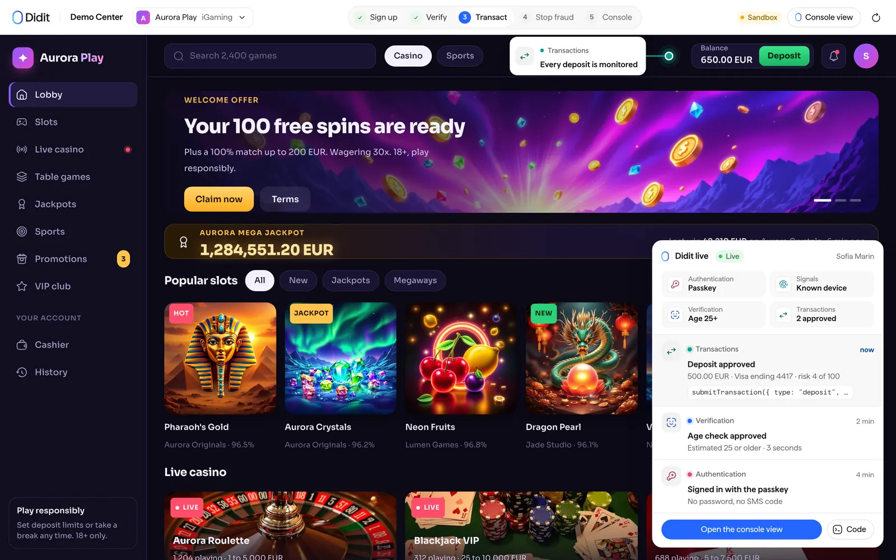
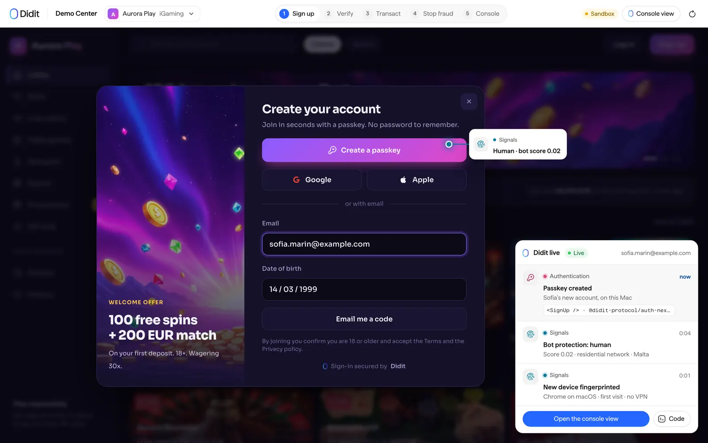
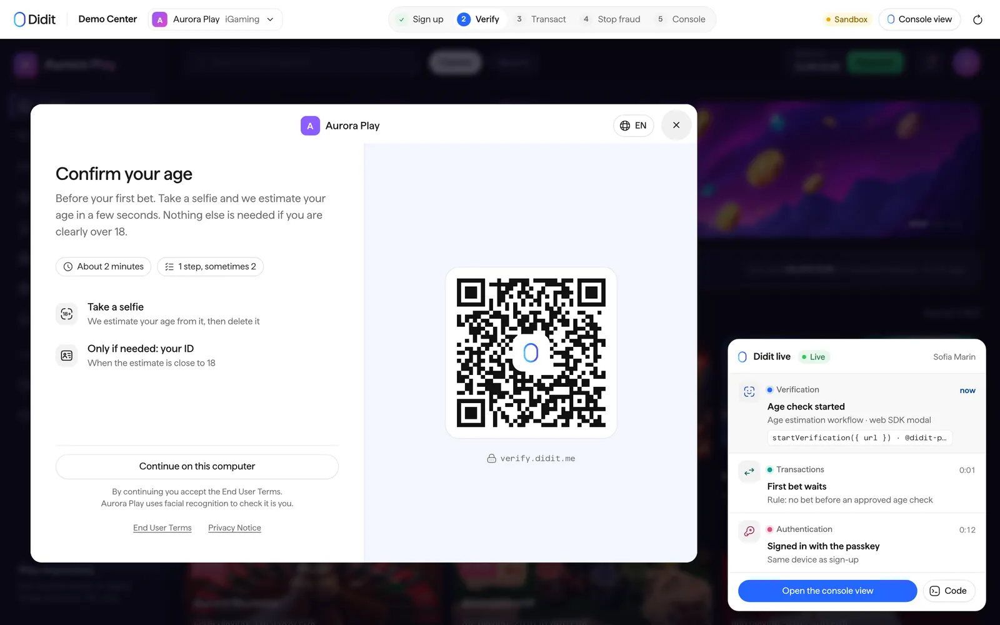
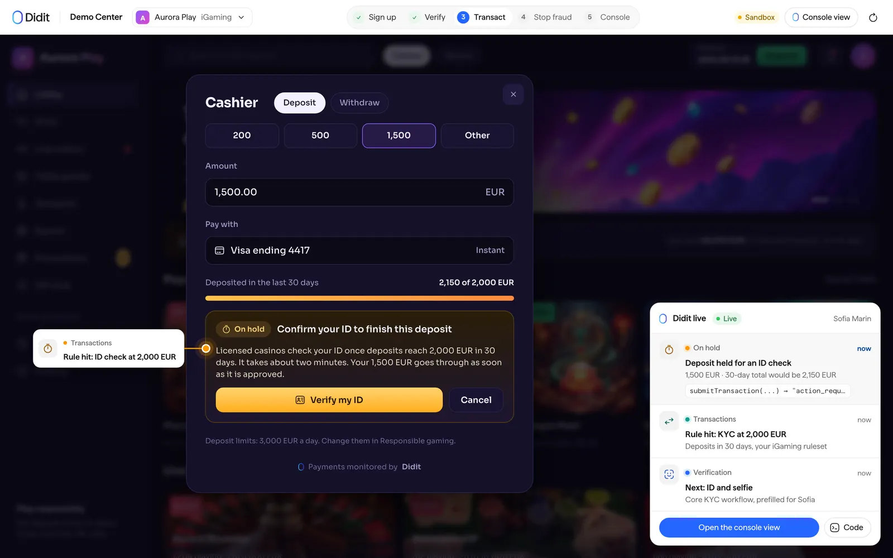
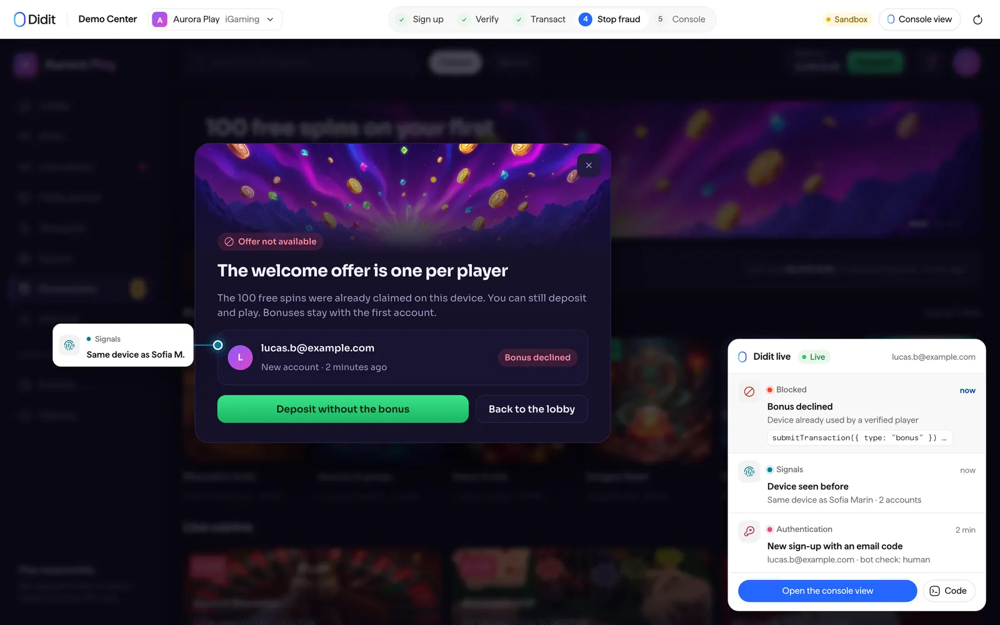
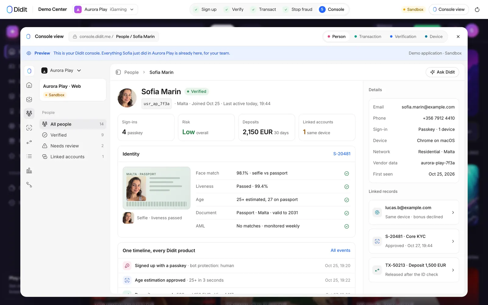
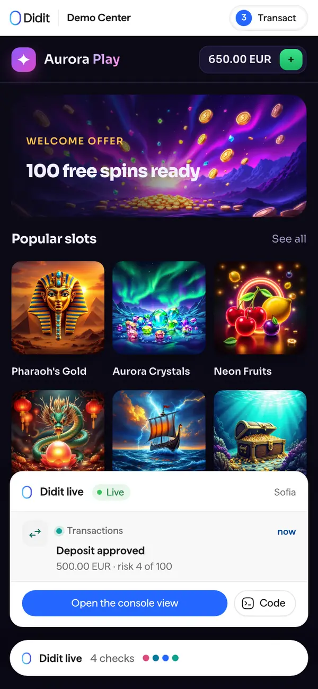
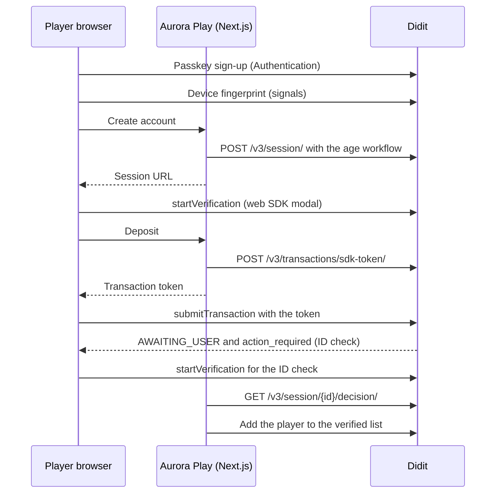

# Online casino KYC, age verification and bonus abuse prevention with Didit (Next.js)

**Aurora Play is an open-source Next.js reference app for an online casino and sportsbook that uses Didit for passkey sign-up, age verification before the first bet, ID checks on large deposits and device-based bonus abuse detection.**
It is for engineers and product owners at iGaming operators who want to see how age estimation, identity verification, Transaction Monitoring and device signals fit together in a real cashier flow.
Every Didit call in it is real code you can read, run against your own Didit application and copy into your product.
The casino is fictional, the integration is not.



Topics: `igaming`, `online-casino`, `kyc`, `age-verification`, `identity-verification`, `responsible-gambling`, `bonus-abuse`, `device-fingerprinting`, `passkeys`, `transaction-monitoring`, `nextjs`, `typescript`, `didit`, `reference-implementation`.

## What it shows

The app walks through five steps.
Each step names the Didit product and the call that does the work.

### 1. Sign up with a passkey (Didit Authentication)

A player creates an account in the casino's own modal.
Passkey comes first, with Google, Apple and an email code as fallbacks, and bot protection on the form.
The app wraps the page in `<DiditAuth>` from `@didit-protocol/auth-nextjs` and lets `diditAuthProxy` serve the sign-up, callback and session routes.



From `middleware.ts` (lines 11-26):

```ts
const proxy = publishableKey()
  ? diditAuthProxy(
      { afterSignOutUrl: "/" },
      {
        DIDIT_PUBLISHABLE_KEY: publishableKey() ?? undefined,
        DIDIT_REDIRECT_URI:
          process.env.DIDIT_REDIRECT_URI?.trim() ||
          `${diditUrls.site}/auth/callback`,
        DIDIT_SESSION_CACHE_SECONDS: process.env.DIDIT_SESSION_CACHE_SECONDS,
      },
    )
  : null;

export default function middleware(request: NextRequest) {
  return proxy ? proxy(request) : NextResponse.next();
}
```

Without a publishable key the app falls back to its own sign-up form and a signed player cookie.

### 2. Age check before the first bet (Didit age estimation)

The server creates a Didit session for the player with the age workflow.
The browser opens the returned URL in the web SDK modal.
Age estimation runs first and falls back to an ID check when the estimate is close to the limit.



From `app/api/igaming/age-check/route.ts` (lines 45-57):

```ts
const result = gateway(
  await diditClient.sessions.create({
    workflowId: AGE_WORKFLOW_ID,
    vendorData: playerId,
    callback: CALLBACK,
    email,
    metadata: {
      operator: OPERATOR_NAME,
      step: "registration",
      ...(fullName ? { full_name: fullName } : {}),
    },
  }),
);
```

From `lib/didit/browser.ts` (lines 49-58):

```ts
    void sdk.shared.startVerification({
      url,
      configuration: {
        showCloseButton: true,
        showExitConfirmation: true,
        closeModalOnComplete: true,
      },
    });
  });
}
```

### 3. Deposits held for an ID check (Didit Transaction Monitoring)

Every cashier action is submitted from the browser with `submitTransaction`, so the web SDK attaches the same device fingerprint that signals collects.
The server only mints a short-lived token bound to the player.
A rule holds a deposit once the player's deposits reach 2,000 EUR in 30 days.
Didit answers with `AWAITING_USER` and an `action_required` URL, and the browser opens it for the ID check.



From `lib/didit/server.ts` (lines 172-185):

```ts
sdkToken(
  input: { vendorData: string; ttlSeconds?: number; maxUses?: number },
  env?: DiditEnv,
) {
  return callDidit<SdkToken>(
    "POST",
    "/v3/transactions/sdk-token/",
    {
      vendor_data: input.vendorData,
      ttl_seconds: input.ttlSeconds ?? 900,
      max_uses: input.maxUses ?? 30,
    },
    env,
  );
```

From `lib/igaming/policy.ts` (lines 442-479):

```ts
{
  ...base,
  title: RULE_TITLES.kycStepUp,
  description: `Once a player's deposits reach ${KYC_THRESHOLD} ${CURRENCY} in ${KYC_WINDOW}, hold the deposit and ask for ID verification. Players on "${LIST_NAMES.verified}" are skipped.`,
  conditions: [
    demoPlayersOnly,
    { field: "direction", operator: "eq", value: "INBOUND" },
    { field: "action_type", operator: "eq", value: "deposit" },
    {
      field: "subject_vendor_data",
      operator: "not_in",
      value: context.verifiedListId,
      value_type: "list",
    },
  ],
  aggregation: [
    {
      metric: "sum",
      field: "amount",
      operator: "gte",
      value: KYC_THRESHOLD,
      window: KYC_WINDOW,
      filters: {
        direction: "INBOUND",
        action_type: "deposit",
        subject_vendor_data: "__current__",
      },
    },
  ],
  actions: [
    {
      type: "change_status",
      value: "AWAITING_USER",
      workflow_id: context.kycWorkflowId,
    },
    { type: "add_tags", tag_name: "KYC_STEP_UP" },
  ],
},
```

### 4. Stop bonus abuse (Didit signals and rules)

`@didit-protocol/signals` fingerprints the device from the first page load.
A rule counts the distinct players that claimed the welcome bonus from one device in 30 days and holds the second claim for review.



From `lib/igaming/policy.ts` (lines 480-506):

```ts
{
  ...base,
  title: RULE_TITLES.bonusSharedDevice,
  description:
    "A welcome bonus claimed by a second player on the same device fingerprint within 30 days is held for review. The classic multi-accounting pattern.",
  conditions: [
    demoPlayersOnly,
    { field: "action_type", operator: "eq", value: "bonus_claim" },
    {
      field: "subject_device_fingerprint",
      operator: "exists",
      value: true,
    },
  ],
  aggregation: [
    {
      metric: "distinct_count",
      field: "subject_vendor_data",
      operator: "gte",
      value: 2,
      window: "30d",
      filters: {
        action_type: "bonus_claim",
        subject_device_fingerprint: "__current__",
      },
    },
  ],
```

### 5. See it in the console

The console view modal shows what each person, transaction and device looks like in the Didit Console, filled with the visitor's own data.
It is a preview drawn by the app, not an embedded console.



The app also works on a phone, and the live feed folds into a pill.



## How it works



## Features and where they live

| Capability | Didit product | Where in the code |
| --- | --- | --- |
| Passkey, Google, Apple and email-code sign-up | Authentication | `middleware.ts`, `app/layout.tsx`, `lib/didit/provider.tsx` |
| Device fingerprint and bot score | Signals SDK | `lib/didit/browser.ts`, `lib/didit/provider.tsx` |
| Age estimation with ID fallback | Verification, age estimation | `app/api/igaming/age-check/route.ts`, `scripts/lib/workflows.mjs` |
| ID check on large deposits | Verification and Transaction Monitoring | `lib/igaming/policy.ts`, `app/api/igaming/verified/route.ts` |
| Monitored deposits and withdrawals | Transaction Monitoring | `app/api/igaming/token/route.ts`, `components/igaming/use-aurora.ts` |
| Welcome bonus once per device | Signals and rules | `lib/igaming/policy.ts` |
| Self-exclusion | Users and lists | `app/api/igaming/self-exclusion/route.ts` |
| Live narration of every event | Demo layer | `demo-layer/` |

## Quick start

You need Node.js 22.18 or later and npm.
The first four steps take about ten minutes.

1. Install the dependencies.

   ```bash
   cd igaming-kyc-age-verification-nextjs
   npm install
   ```

2. Create a free Didit account in the [Didit Console](https://business.didit.me).
   Open your application and copy its API key.
   A key that starts with `sk_test_` belongs to a sandbox application, a key that starts with `sk_live_` to a live one.
   See [sandbox and test data](https://docs.didit.me/integration/sandbox-testing) for what the sandbox does and does not run.
3. Copy the environment file and paste the key.

   ```bash
   cp .env.example .env
   # then set API_KEY=... in .env
   ```

4. Create the 2 workflows and the rules this app needs on your Didit application.
   The script finds what already exists by name, creates only what is missing, and writes the workflow ids to `.env`.

   ```bash
   npm run setup
   ```

   Add `-- --dry-run` to print what it would change without changing anything.
5. Start the app and open [http://localhost:3000](http://localhost:3000).

   ```bash
   npm run dev
   ```

Two things to know before you test the transaction steps.

- Verification sessions on a sandbox application are never billed and use test data.
  Transaction Monitoring does not evaluate rules for a sandbox application, so the held transactions and the step-ups that follow them only appear on a live application, at the [list prices](https://docs.didit.me/getting-started/pricing).
- Didit Authentication is turned on per application by Didit.
  When you have a publishable key, set `DIDIT_PUBLISHABLE_KEY` and register `http://localhost:3000/auth/callback` as a redirect URI.
  Without a key the app keeps its own sign-in form and everything else still works.

## Configuration

| Variable | Required | What it is |
| --- | --- | --- |
| `API_KEY` | Yes | Server-side Didit API key from your application in the Didit Console. Never sent to the browser. |
| `NEXT_PUBLIC_SITE_URL` | No | This app's public URL, used for callbacks and redirects. Defaults to `http://localhost:3000`. |
| `DIDIT_WORKFLOW_AGE` | Written by `npm run setup` | Age check opened before the first bet (age estimation, ID check as the fallback). |
| `DIDIT_WORKFLOW_KYC` | Written by `npm run setup` | ID check opened when deposits reach 2,000 EUR in 30 days (ID, liveness, face match, IP). |
| `DIDIT_PUBLISHABLE_KEY` | No | Didit Authentication publishable key (`pk_test_` or `pk_live_`). Empty keeps the app's own sign-in form. |
| `DIDIT_REDIRECT_URI` | No | The callback registered for the Authentication application. Defaults to the site URL plus `/auth/callback`. |
| `DIDIT_SESSION_CACHE_SECONDS` | No | Seconds the Authentication session is cached before it is checked again. |
| `DIDIT_CONSOLE_ORG_ID` | No | Organization id behind `API_KEY`, for Console deep links. Read from the API when empty. |
| `DIDIT_CONSOLE_APP_ID` | No | Application id behind `API_KEY`, for Console deep links. Read from the API when empty. |

## Project structure

```text
app/page.tsx                         The app, served at /
app/layout.tsx                       Root layout: Didit Authentication provider and signals
app/api/igaming/                     Route handlers that call Didit with the server-side key
app/api/didit/events-token/route.ts  Mints the monitoring token the browser sends signals events with
middleware.ts                        Didit Authentication routes and session refresh
components/igaming/                  The screens and the hook that drives the flow
lib/igaming/                         What this app sends to Didit and the rules it installs
lib/didit/                           The shared Didit client: server calls, browser SDK helpers, Authentication, signals
demo-layer/                          The Didit live layer and the console view (demo only, see below)
scripts/setup.mjs                    npm run setup: workflows, rules and lists on your Didit application
styles/                              The app's own look
tests/                               Unit tests (npm test) and the recorded Didit answers they use
e2e/                                 Playwright end-to-end tests that replay recorded answers
public/                              Images the app uses and the Didit logo
```

## Adapt it to your product

1. Replace the brand.
   The look lives in `styles/aurora.css`, the copy and screens in `components/igaming/`, and the name and rules text in `lib/didit/demos.ts`.
2. Change the policy.
   The 2,000 EUR threshold, the 30 day window and the welcome bonus are constants at the top of `lib/igaming/policy.ts`, and the rules built from them are installed by `npm run setup`.
3. Change the workflows.
   `scripts/lib/workflows.mjs` holds the age and ID workflow definitions.
   You can also build them in the Didit Console and paste their ids into `.env`.
4. Match your licence.
   Which checks you need before the first deposit depends on your jurisdiction and licence, so set the rules to your own compliance policy.
5. Persist what you need.
   The demo keeps state in cookies and in Didit, so add your own database for balances, bets and player records.

## Remove the demo-only layers

Everything that exists only to teach what happens lives in one folder, `demo-layer/`.
It holds the "Didit live" feed that narrates each Didit event, the callouts pinned to the app, the console view modal, the demo bar with the five steps, and the event builders and console pages that feed them.
Your product does not need any of it.
The Didit integration itself does not depend on the layer: Authentication, signals, the web SDK modal, transaction submission and the route handlers live in `lib/didit/`, `lib/igaming/` and `app/api/`.

The layer is reached from a handful of files, listed below, so removing it is a short, mechanical job.
It is not a one-line switch, because the demo screen mixes the app with the walkthrough.

1. Delete the `demo-layer/` folder.
2. In `app/page.tsx`, delete the `import "@/demo-layer/live.css"` line.
3. In the demo screen (the `*-demo.tsx` file under `components/`), replace the `<DemoShell>` wrapper with a plain `<div>` that keeps the `data-app` attribute, because the app's stylesheet is scoped to it.
   Then delete the blocks that only feed the walkthrough: the `live` store and every `live.push(...)` call, the `callouts`, `consoleTabs`, `tiles` and `integration` values, the console modal state, and the step bookkeeping (`done`, `step`, `onStep`).
4. In the other files below, delete the imports of `@/demo-layer/...` and the lines that use them.
5. Delete `public/brand/` if you do not show the Didit logo.
6. Run `npm run typecheck` and fix what it reports.
   The tests that cover the event builders and console pages (`*-live.test.mjs`) go with the layer.

These files import the layer:

- `app/page.tsx`
- `components/igaming/aurora-demo.tsx`
- `components/igaming/modals.tsx`

## Security notes

- The Didit API key is server-side only.
  It is read in `lib/didit/config.ts` and used by the route handlers in `app/api/`.
  The browser never sees it: it gets a session URL for the web SDK, a short-lived transaction token (`POST /v3/transactions/sdk-token/`) or a monitoring token for signals events.
- The tokens are bound to one `vendor_data` when the server mints them.
  Didit takes the subject of every transaction and event from the token, so a tampered browser cannot submit on behalf of another person.
- Every route that returns Didit data re-checks that the record belongs to the visitor who started it.
  The demo identity is either the signed-in Didit Authentication user or a signed, httpOnly cookie.
- Verification decisions are read from the API with the server-side key (`GET /v3/session/{id}/decision/`).
  This app does not receive webhooks.
  If you add a webhook endpoint, read the raw request body and verify the `X-Signature-V2` HMAC-SHA256 signature before you trust it, as described in the [webhooks guide](https://docs.didit.me/integration/webhooks).
- Do not commit `.env`.
  `.gitignore` already excludes it, and `.env.example` holds no secrets.
- Rotate the API key in the Didit Console if it ever leaks.

## Testing

```bash
npm run typecheck   # TypeScript
npm run lint        # ESLint (next lint)
npm test            # unit tests, no Didit account needed
npm run build && npm run test:e2e   # Playwright against the production build
```

The unit tests and the end-to-end tests replay recorded Didit answers from `tests/fixtures/`.
They need no API key and never bill your application.
`npm test` loads fake workflow ids from `tests/test.env`.
Install the Playwright browser once with `npx playwright install chromium`.

## Deploy

The app is a standard Next.js 15 application with route handlers and middleware, so it runs on Vercel or on any Node host.

1. Set the variables from `.env.example` in your host's environment, with `NEXT_PUBLIC_SITE_URL` set to the public URL.
2. Run `npm run build` and `npm run start`, or let Vercel build it.
3. If you use Didit Authentication, add `<your URL>/auth/callback` to the application's redirect URIs and your URL to its allowed origins in the Didit Console.
4. Run `npm run setup` once against the application you deploy with.

The demo keeps its state in signed cookies and in Didit itself.
Before you take real traffic, move anything you need to keep into your own database.

## FAQ

### How do I add age verification to an online casino?

Create a Didit workflow with the age estimation feature and ID verification as the fallback, create a session for the player at sign-up, and open its URL in the web SDK modal.
Block the first bet until the decision is approved.
This repo does exactly that: see `app/api/igaming/age-check/route.ts` and `lib/didit/browser.ts`.
Age estimation is priced at $0.10 per check on the [Didit price list](https://docs.didit.me/getting-started/pricing).

### Do I need KYC before the first deposit?

It depends on your licence and jurisdiction, so ask your compliance team.
This demo shows one common pattern: an age check before the first bet, and a full ID check when deposits reach 2,000 EUR in 30 days.
Both thresholds are plain constants you can change.

### How do I stop bonus abuse and multi-accounting?

Fingerprint the device with `@didit-protocol/signals`, submit the bonus claim as a monitored transaction, and add a rule that counts distinct players per device.
The second claim from the same device is held for review.
See `lib/igaming/policy.ts` for the rule.

### Can players sign up with a passkey?

Yes, with Didit Authentication.
The sign-up page offers a passkey, Google, Apple and an email code, and a returning player signs in with the passkey.
Authentication is enabled per application, so ask Didit to turn it on and set `DIDIT_PUBLISHABLE_KEY`.

### How much does this cost to run?

Didit prices every check per call.
The iGaming bundle (KYC, AML screening and age estimation) is $0.63 per verification and a monitored transaction is $0.02.
Sessions on a sandbox application are never billed.
Check the [price list](https://docs.didit.me/getting-started/pricing) and [didit.me/pricing](https://didit.me/pricing) for the current plans.

### Does it work without Didit Authentication?

Yes.
Without a publishable key the casino uses its own sign-up form and a signed player cookie, and the rest of the flow is unchanged.

### How do I test without real documents?

Use a sandbox application.
Didit's [sandbox](https://docs.didit.me/integration/sandbox-testing) mocks the providers and lets you drive each outcome with test values.
Remember that Transaction Monitoring rules do not run on a sandbox application.

### Is this production ready?

It is a reference implementation.
The Didit integration patterns are the ones to copy, but you still need your own persistence, responsible gambling tooling and licence-specific rules before you go live.

## Docs and live demo

- Live demo: [https://demos.didit.me/igaming](https://demos.didit.me/igaming)
- Didit documentation: [docs.didit.me](https://docs.didit.me)
- Didit Authentication: [overview](https://docs.didit.me/authentication/overview) and [Next.js quickstart](https://docs.didit.me/authentication/quickstarts/nextjs)
- Web SDK: [JavaScript SDK](https://docs.didit.me/integration/web-sdks/javascript-sdk)
- Transaction Monitoring: [SDK transaction submission](https://docs.didit.me/transaction-monitoring/sdk-transaction-submission), [SDK event submission](https://docs.didit.me/transaction-monitoring/sdk-event-submission) and [rules API](https://docs.didit.me/transaction-monitoring/rules-api)
- Workflows: [create a workflow](https://docs.didit.me/management-api/workflows/create)
- Pricing: [docs.didit.me/getting-started/pricing](https://docs.didit.me/getting-started/pricing) and [didit.me/pricing](https://didit.me/pricing)

## License

MIT, copyright Didit.
See [LICENSE](LICENSE).
